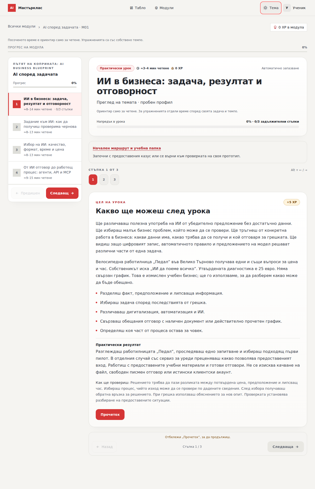
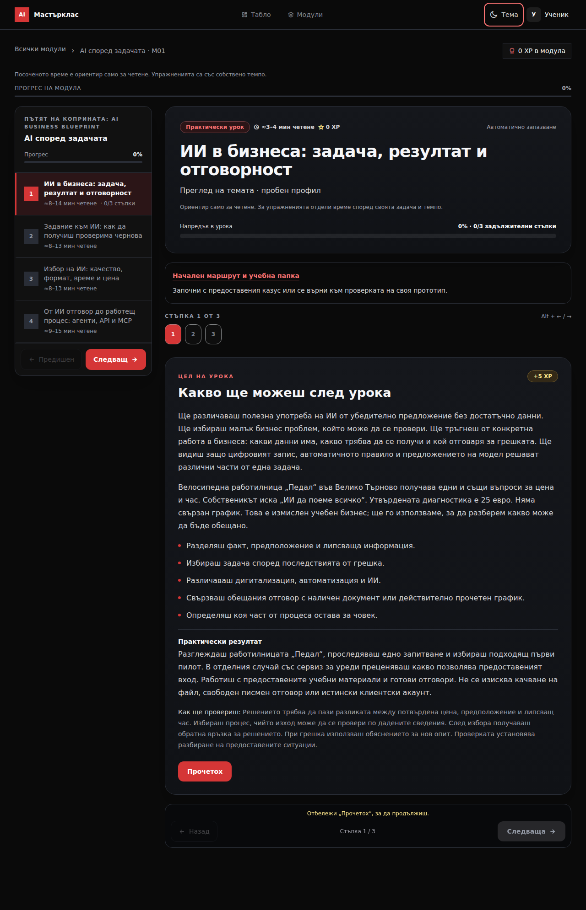

# Пробна светла и тъмна тема за Академия TAVORA

Пробната версия добавя избор „Тъмна“, „Светла“ и „По устройството“ в учебната навигация. Изборът се запомня в този браузър отделно за всеки профил и за гости. При автоматичния избор изгледът следва настройката на устройството.

Темата обхваща таблото, модулите, уроците, речника, формите за избор, таблиците, учебните демонстрации и обратната връзка. Кадрите, снимките и учебните схеми запазват собствените си цветове. Превключването запазва текущата стъпка, отговора и показаното обяснение.

Това е отделна пробна версия за преглед, без публикуване в live сайта. Няма синхронизация на настройката между устройства. Не се изисква миграция в Supabase.

## Преглед на светлия урок

## Преглед на тъмния урок

Снимките са от автоматизиран браузърен преглед с пробен профил и примерни стойности. Първата страница е от съществуващия безплатен урок; останалите тестови блокове служат само за проверка на интерфейса и не заменят публикуваното съдържание.

## Проверка

При първоначалната подготовка минаха 420 автоматизирани проверки; 8 съществуващи проверки са пропуснати. След разширената проверка на лабораториите от 14.10.2026 г. минаха 113 целеви проверки в 8 файла, типовата проверка, lint, проверката на разпространяваното съдържание и изграждането на приложението.

Общо 29 браузърни проверки покриват:

- Запомняне след презареждане, автоматичен избор и изгледи на 320, 375 и 1280 пиксела.
- 15 вида учебни блокове в общите компоненти за трите курса: запазване на стъпка, частичен избор, свързване, подреждане, карти, отметки, грешен и поправен отговор и изпит. Смяната не предава нов опит и не добавя XP.
- Всичките 11 видео демонстрации, всеки вариант и шестте аудиофайла. Изборът, времето и възпроизвеждането остават запазени; цветовете в схемите остават същите.
- Двата случая в началния прототип на „Пътят на коприната“, повторени заявки, липсващ контакт, неуспех и действителна проверка на формата. Отделната вградена форма също приема заявка с клавиатура и запазва журнала.
- Всички 10 условия в симулациите за плащане, публикуване и заявки, включително рестартиране и запазване на резултатите при смяна на тема.
- Самостоятелните HTML упражнения: шест проверки на заявките, седем гранични сметки, 20 CRM случая и 10 имейл случая. Те запазват собствения си изглед; прототипите и изтеглените примери също имат отделни цветове.

Поправени са белият текст в полетата, понятията и името на случая в светлата начална лаборатория и нечетливата избрана видео демонстрация. Поправено е и блокираното изпращане в двете защитени рамки на „Пътят на коприната“: позволено е действието на формата, а достъпът до страницата и профила на родителя остава забранен. Добавен е избор на тема и в обвивката на отделната форма.

Браузърните проверки са изпълнени в Chromium. Учебните компоненти са проверени с ясно означени пробни блокове за трите курса; това не е ръчен обход на всеки публикуван урок или проверка в Safari и Firefox. Проверката на контраста обхваща показания текст и активните контроли и се допълва от визуален преглед; тя не представлява пълен одит на достъпността.

Браузърният преглед използва само синтетични заявки: няма вход в реален профил, изпращане на съобщения, покупка или запис на учебни резултати в live базата.

За повторение: `npm run test:themes-browser`. Командата изгражда пробна версия с фиктивен API адрес и всички заявки се прихващат от тестовете.

Автоматичният избор използва [prefers-color-scheme](https://developer.mozilla.org/en-US/docs/Web/CSS/Reference/At-rules/@media/prefers-color-scheme) и [matchMedia](https://developer.mozilla.org/en-US/docs/Web/API/Window/matchMedia).
Действието на вградените форми използва [allow-forms](https://developer.mozilla.org/en-US/docs/Web/HTML/Reference/Elements/iframe#allow-forms), без разрешение `allow-same-origin`.
